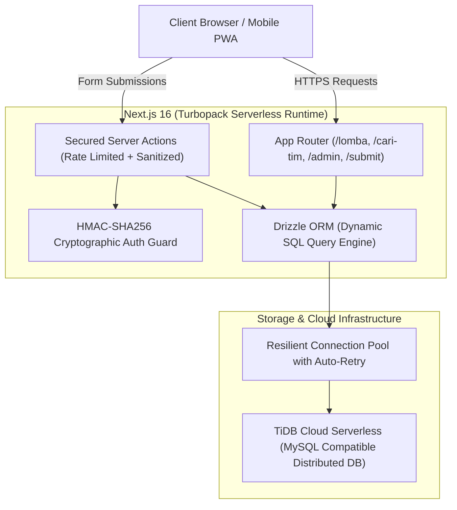

# naviable.id — Direktori Kompetisi & Matchmaking Pelajar Indonesia
> **Finalist Submission for DeveloperDay.id 2026**  
> *Platform agregator kompetisi resmi, kurasi terverifikasi bebas scam, dan matchmaking rekan tim lintas SMA/SMK se-Indonesia.*

[](https://nextjs.org/)
[](https://react.dev/)
[](https://orm.drizzle.team/)
[](https://tidbcloud.com/)
[](https://tailwindcss.com/)
[](https://nodejs.org/api/crypto.html)

---

## 📌 Latar Belakang & Masalah (Problem Statement)
Setiap tahun, ratusan ribu siswa SMA, SMK, dan MA di Indonesia berburu sertifikat kompetisi untuk jalur prestasi perguruan tinggi negeri (SNBP), beasiswa, maupun portofolio kerja. Namun, mereka menghadapi 3 kendala utama:
1. **Informasi Tersebar & Rawan Scam**: Info lomba tersebar di puluhan akun Instagram, poster buram, biaya pendaftaran fiktif, atau lomba tanpa akreditasi resmi.
2. **Ketiadaan Rekan Tim Komplementer**: Siswa SMK jurusan RPL kesulitan mencari rekan desainer UI atau presenter, begitu pula siswa SMA yang ingin ikut Hackathon/LKTI sering gugur karena tim tidak lengkap.
3. **Dead-end Matchmaking**: Formulir cari teman tim konvensional sering berujung ghosting karena tidak adanya kanal komunikasi langsung.

**naviable.id** hadir memecahkan masalah ini dengan direktori terverifikasi, pencarian berbasis SQL performa tinggi, dan ekosistem matchmaking rekan tim dengan integrasi komunikasi instan.

---

## 🏛️ Arsitektur Sistem (System Architecture)



---

## ✨ Fitur-Fitur Unggulan

### 1. Direktori Lomba Terkurasi & Filter Dinamis SQL
* **Bebas Scam**: Hanya kompetisi terverifikasi yang tayang di katalog publik.
* **Server-side SQL Filtering**: Pencarian kata kunci, jenjang (SMA/SMK/MA), kategori keahlian, tingkat (Kota s/d Internasional), serta rentang biaya diproses langsung di level database MySQL/TiDB menggunakan Drizzle ORM tanpa bloating memory server.
* **Non-blocking Metrics**: Counter impresi halaman berjalan secara asinkron tanpa menahan *Time To First Byte* (TTFB) dan kebal terhadap bot crawling.

### 2. Ekosistem Matchmaking Rekan Tim (Peer-to-Peer)
* **Perekrutan Berbasis Role**: Tim yang kekurangan peran spesifik (e.g. *UI/UX Designer*, *Embedded Hardware*, *Presenter Pitching*) dapat mempublikasikan lowongan.
* **Talent Pool Siswa**: Siswa dapat memajang profil keahlian (*Free Agent*) agar diajak bergabung oleh tim potensial.
* **Anti-Ghosting Direct Connect**: Pengajuan lamaran tim secara otomatis memicu link WhatsApp terformat ke nomor ketua tim, memastikan respons instan tanpa surat kaleng.

### 3. Keamanan Tingkat Lanjut (Production Security Guard)
* **HMAC-SHA256 Signed Sessions**: Panel admin menggunakan cookie sesi terenkripsi dengan payload timestamp + nonce kriptografis dan verifikasi waktu-konstan (`crypto.timingSafeEqual`) untuk menangkal *timing attacks*.
* **Protected Server Actions**: Operasi sensitif (`deleteCompetitionAction`, `toggleVerifyCompetitionAction`) diverifikasi dengan server-side session guard.
* **Sliding-Window Rate Limiting**: Menahan serangan bot flooding / spamming pada form submisi lomba dan lamaran tim.
* **HTML Tag Sanitization**: Mencegah serangan Cross-Site Scripting (XSS) pada input pengguna.

---

## 🛠️ Tech Stack & Spesifikasi

| Lapisan | Teknologi | Keterangan |
|---|---|---|
| **Framework** | Next.js 16.4.3 (Turbopack) | Server Components, App Router, React 19 |
| **Styling** | Tailwind CSS v4, Lucide Icons | Responsive Mobile-First, Bento-box Grid |
| **Database** | TiDB Cloud Serverless | Distributed SQL, High Availability |
| **ORM** | Drizzle ORM 0.33 | Type-safe SQL Builder & Migrations |
| **Keamanan** | Node.js Crypto (HMAC-SHA256) | Zero External Dep Session Auth |
| **Validasi** | Zod 3.23 + React Hook Form | Full Type-Safe Schema Validation |

---

## 🚀 Panduan Menjalankan Project (Local Development)

### 1. Prasyarat
* Node.js v20+ atau v22+
* pnpm v10+

### 2. Instalasi Dependensi
```bash
cd findmycompetition
pnpm install
```

### 3. Konfigurasi Environment (`.env`)
Buat atau sesuaikan file `.env` di folder `findmycompetition`:
```env
DATABASE_URL="mysql://<user>:<password>@<host>:4000/<database>"
ADMIN_PASSWORD="supersecretadminpassword"
ADMIN_SESSION_SECRET="kunci_rahasia_hmac_sha256_minimal_32_karakter"
```

### 4. Push Schema Database
```bash
pnpm db:push
```

### 5. Jalankan Development Server
```bash
pnpm dev
# Atau jika di Windows PowerShell:
pnpm.cmd dev
```
Buka browser pada [http://localhost:3000](http://localhost:3000).

---

## 🏆 Kesiapan Penjurian DeveloperDay.id

1. **Innovativeness**: Menggabungkan katalog kurasi terakreditasi dengan matchmaking tim lintas sekolah di 38 provinsi.
2. **Technical Excellence**: Transisi dari in-memory array filtering menjadi dynamic indexed SQL query, zero-bloat serverless architecture, dan cryptographic session verification.
3. **User Centricity**: UI intuitif bergaya modern bento, aksi mobile dengan sticky navigation bar, dan penghubung WhatsApp otomatis tanpa dead-end.
4. **Resilience**: Database connection pooling dengan penanganan drop/reset otomatis via `withDbRetry()`.

---

© 2026 Tim Pengembang **naviable.id** — Dibuat untuk DeveloperDay.id.
